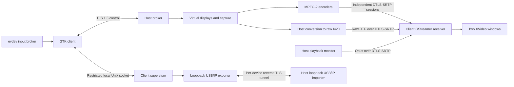

# Protocol and runtime architecture

The appliance keeps networking, local input ownership and media presentation
on the laptop. Host platform adapters capture two independent logical displays
and inject input into the selected host seat/session. Control and media remain
separate so bulk traffic does not occupy the control connection's write queue.

## Trust and framing

Each installation generates an EC P-256 self-signed identity and pins the exact
SHA-256 certificate fingerprint. Tailscale enrollment provides routing; it does
not replace application pairing. A first connection requires a separately
verified host fingerprint and a one-use host code. The host adds the client
fingerprint to its private allowlist only after validating that code.

TLS requires version 1.3. Certificate validity is checked and private state is
restricted to the service owner (SYSTEM/Administrators on Windows). Application
messages have a four-byte, network-order byte count followed by UTF-8 JSON.
The maximum frame is 64 KiB, JSON nesting is bounded, and queued control data
is limited to 256 KiB. Idle/handshake timeouts release control. Unauthenticated
application errors immediately close the connection. One client controls a
host at a time; additional connections are refused while that slot is occupied.

The `hello` exchange advertises version 1. `capabilities`, `start`, `offer`,
`media_ready`, `input`, `release_all`, `display_changed`, `keyframe`, `stats`,
`device_list`, `attach_device`, `open_tunnel`, `detach_device`, `ping`, `pong`,
`status`, `disconnect` and `error` cover the implemented session transitions.
Input uses evdev key codes on both hosts. The power key is forbidden by the
protocol. Pointer coordinates are mapped from encoded dimensions into the
logical host monitor's rectangle.

Default ports:

| Direction | Port | Purpose |
|---|---|---|
| Client → host | TCP 47010 | Control/pairing/input |
| Client → host | TCP 47011 | Per-device reverse TLS, only when USB is enabled |
| Bidirectional | Host UDP 47020/47021, client UDP 48020/48021 | Independent video DTLS/RTP/RTCP |
| Bidirectional | Host UDP 47022, client UDP 48022 | Playback audio DTLS/RTP/RTCP |
| Local laptop only | TCP 127.0.0.1:3240 | Patched USB/IP exporter |
| Local host only | Ephemeral TCP 127.0.0.1 port per device | USB/IP importer entrance |

Direct mode needs reachable control and media paths. The client initiates DTLS;
the host learns the client's UDP source port only from the authenticated control
peer's IP, then locks it after certificate verification. Tailscale uses its
normal TUN interface. No UPnP router configuration or public USB/IP listener is
created. Firewall scope remains a host installation decision.

## Media ownership and performance

Control carries both media certificate fingerprints. GStreamer handles DTLS,
SRTP and SRTCP; application gates prevent encoded payloads from flowing until
both sides report verification over the authenticated control connection.
The appliance patches GStreamer's DTLS transport to require DTLS 1.2 or newer.

The 0.1.12 application host also offers trusted-network plain RTP/UDP. The
paired TLS control session negotiates that mode, a fresh per-stream SSRC,
frame-preserving MPEG-2 payload and a 10 ms jitter budget. Peer address/port
and SSRC checks isolate sessions but do not encrypt or authenticate LAN media.
Tailscale retains its own WireGuard protection. Plain mode uses directly
reachable negotiated ports without NAT port learning, and a standalone
`rtpjitterbuffer` instead of the DTLS/RTCP `rtpbin` path. Service configuration
defaults and peers lacking the new capabilities retain encrypted legacy media.

Each MPEG-2 stream has its own jitter handling, decoder and sink. New peers
use `rtpgstpay`/`rtpgstdepay` to preserve a complete encoded picture, allowing
direct decoding without receiver elementary-stream parser lookahead. Legacy
MPV framing retains the parser. Encoding is progressive
YUV420 with no B-frames and a half-second GOP. Legacy client jitter starts at 40 ms;
decoded queues are bounded and leaky. Loss requests keyframes. Audio uses Opus
48 kHz stereo at 96 kb/s. Production client sinks are XVideo and ALSA. A zero
window handle explicitly selects a headless sink only for tests.

The adaptive controller lowers frame rate before reducing encoded dimensions,
with sustained-load and recovery thresholds. Logical host geometry remains
stable during quality changes. Renegotiation currently restarts media and can
produce a short interruption. Per-stream decoded buffers/fps, jitter loss/late
counts and queue time are reported; control ping measures round-trip latency,
not complete input-to-photon latency.

The wired profile instead sets the laptop display's `codec` to `raw-i420`,
`fps` to 60 and `bitrate` to zero (there is no encoder bitrate setting). The
host performs BGRA-to-I420 conversion and scaling, then uses `rtpvrawpay`.
The client uses `rtpvrawdepay` followed by its bounded presentation queue and
XVideo sink, bypassing a codec decoder and CPU color conversion. Host input
buffers are reused through a bounded GStreamer pool. A separate VGA stream
can continue using MPEG-2 while the panel uses raw video. Raw framing follows
the existing [GStreamer RFC 4175 payloader](https://gstreamer.freedesktop.org/documentation/rtp/rtpvrawpay.html).

Raw 1366×768 I420 at 60 fps requires `1366 × 768 × 12 × 60 = 755343360`
payload bits per second. This shifts codec work to the host but cannot remove
client-side network, cryptographic and memory-bandwidth costs. The UI provides
an explicit wired profile and retains MPEG-2 for Wi-Fi. Stream quality is
reported as negotiated and measured; no 60 fps HP performance claim is inferred
from a successful workstation loopback test.

## USB ownership

The client supervisor checks peer credentials on its Unix socket, rechecks the
administrator's VID/PID/serial policy, and refuses HID, hubs, network interfaces,
the configured boot disk, mounted storage and swap. It starts only the image's
patched loopback-only USB/IP daemon. Export leases are tied to the UI process
and expire if the process dies or stops sending keepalives.

A device tunnel requires the paired certificate, current control session,
device bus ID and a random single-use grant. At most eight grants/handshakes
are retained. Each relay direction has a 16 KiB buffer with backpressure and
a 4 MiB/s pacing ceiling. That ceiling is not camera-format negotiation or
proof that a mode works over Wi-Fi. Webcam profile restrictions still require
the actual device's descriptor/mode qualification before support is declared.

Linux clean detach requires host storage to be ejected and flushes unmounted
imported block devices before VHCI detach. Connection loss closes the tunnel
and has physical-unplug semantics. Windows USB import/eject integration remains
disabled until its signed driver's safe device mapping is implemented and
qualified.

## Privilege and lifecycle

The GTK shell and browser run as the unprivileged appliance user. The small root
supervisor accepts fixed power and USB actions; no arbitrary command or path is
accepted. The authentication browser has no credential/script bridge to the
shell and runs only after the remote session is stopped.

Windows uses a LocalSystem session broker plus a capture/input helper. Linux
uses a privileged host service, EVDI/uinput and explicit RandR/LightDM mappings.
Neither platform can expose pre-OS firmware or disk-unlock screens. Successful
compilation and synthetic media tests do not establish unattended login/lock
support on either operating system.
